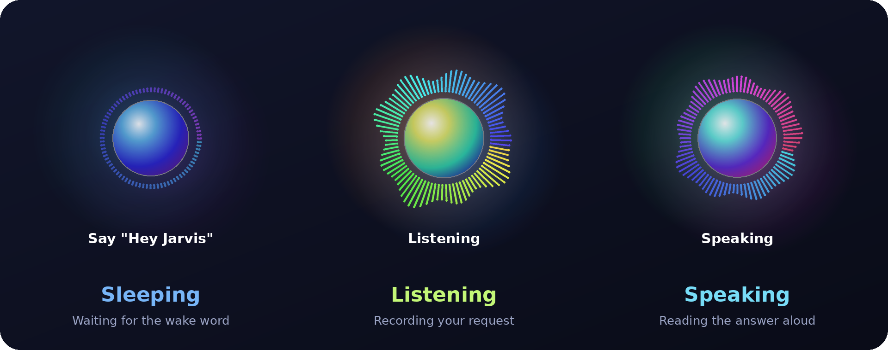
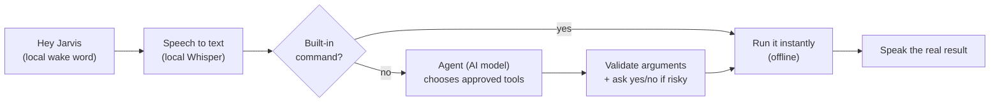

# Jarvis: a voice assistant that controls your Windows PC

Say **"Hey Jarvis"**, then ask for something in plain words: open an app, set a timer, find a file, minimize a window, ask a question. Jarvis answers out loud.

Wake-word detection, speech recognition and speech output all run **on your own PC**. Only requests that your built-in commands can't handle are sent to an AI model, and that AI can only use a short list of approved, validated tools.

<p align="center">
  
</p>

The floating orb shows what Jarvis is doing:

| State | Orb | Meaning |
|---|---|---|
| **Sleeping** | Calm cyan-blue ring, tiny bars | Waiting for "Hey Jarvis" (the only thing it is listening for) |
| **Listening** | Warm, bright, tall bars that follow your voice | Recording your request |
| **Thinking** | Violet, with three arcs orbiting the core | Working out what to do |
| **Speaking** | Green-teal and magenta, pulsing | Reading the answer aloud |

## Features

- **Hands-free.** Local wake word ([openWakeWord](https://github.com/dscripka/openWakeWord)), then it detects when you stop talking. No keyboard needed.
- **Local speech recognition** with [faster-whisper](https://github.com/SYSTRAN/faster-whisper). Choose `tiny.en`, `base.en` or `small.en` to trade speed for accuracy.
- **Offline voice** using the speech engine built into Windows.
- **Instant built-in commands:** open apps (including Microsoft Store apps like WhatsApp), websites, web and YouTube search, voice typing, screenshots, volume, time, date, battery.
- **An agent for everything else.** Ask in your own words and the AI picks from approved tools: timers, files and folders, windows, keyboard shortcuts, media keys, brightness, clipboard, calculator, system info.
- **Asks before anything risky**, out loud: closing windows, moving or replacing files, deleting, restart or shutdown. Silence counts as "no".
- **Keeps the conversation going.** If Jarvis asks a question, it keeps listening for your answer without the wake word.
- **Typed mode** if you would rather not use a microphone.

## How it works



1. Your **built-in commands** run first. They are instant and work offline.
2. Anything they don't match goes to the **agent**. The AI replies with a small JSON plan naming tools. It never gets a shell or free-form code execution.
3. Every tool name and argument is **validated** before anything runs. Risky actions ask you first, and the question is written by the program, not the AI.
4. What Jarvis tells you afterwards is the **actual result** of the tool, not the AI's claim.

## Requirements

- Windows 10 or 11
- Python 3.10 or newer
- A microphone and speakers (or headset)
- An API key for any OpenAI-compatible AI service for the agent (for example [Groq](https://console.groq.com/)), or a local server such as Ollama. Without one, Jarvis still works with its built-in commands.

## Installation

```powershell
git clone https://github.com/Babarinde1/Voice-Assistant-AI-agent.git
cd Windows_Voice_Assistant
python -m venv .venv
.venv\Scripts\Activate.ps1

python -m pip install -r requirements.txt
python setup_wake_word.py          # downloads the wake-word model once (needs internet)
```

Create your settings file and fill it in:

```powershell
copy .env.example .env
notepad .env
```

At minimum, for the agent, set `AI_API_KEY` and `AI_MODEL` (use the exact model name from your provider). Everything else has a sensible default. **Never commit `.env`**; it is already in `.gitignore`.

## Running

```powershell
python main.py --wake            # hands-free: say "Hey Jarvis"
python main.py                   # typed mode (type a command; press Enter on an empty line to speak)
python main.py --wake --no-overlay   # without the floating orb
python main.py --diagnostics     # show what is set up, without opening the microphone
python main.py --say-time        # speak the time once, to test the voice
```

### Things to try

| Say | What happens |
|---|---|
| "Open Chrome" / "Open WhatsApp" | Built-in launcher |
| "What time is it?" | Spoken aloud |
| "Search YouTube for lo-fi music" | Opens the search |
| "Set a timer for ten minutes for the rice" | Speaks when time is up |
| "Create a new folder on my desktop" | Asks for a name, then creates it |
| "Find my CV and open it" | Searches your folders, then opens the file |
| "Minimize VS Code" / "Switch to Chrome" | Window control |
| "Set the volume to 30" / "Pause the music" | Volume and media keys |
| "What's 15 percent of 8400?" | Calculator |
| "Lock the computer" | Locks Windows |

## Configuration

All settings live in `.env` (see `.env.example` for the full list with explanations). The most useful ones:

| Setting | Default | What it does |
|---|---|---|
| `AI_API_KEY`, `AI_MODEL`, `AI_BASE_URL` | empty | The AI service used by the agent |
| `STT_MODEL` | `base.en` | `tiny.en` (fastest), `base.en`, `small.en` (most accurate) |
| `WAKE_WORD_THRESHOLD` | `0.5` | Lower wakes more easily but can trigger by mistake |
| `MIC_GAIN` | `1.0` | Software boost for a quiet microphone |
| `END_SILENCE_MS` | `900` | How long a pause means "I'm done talking" |
| `ORB_STYLE` | `auto` | `auto`, `qt` (transparent), `tk` (simple) or `off` |
| `AGENT_ENABLED` | `true` | Turn the AI agent on or off |
| `FOLLOW_UP_ENABLED` | `true` | Keep listening after Jarvis asks a question |
| `ALLOWED_FOLDERS` | empty | Extra folders the file tools may use |
| `ALLOW_FILE_DELETION` | `false` | Lets Jarvis send files to the Recycle Bin (always asks first) |
| `ALLOW_POWER_ACTIONS` | `false` | Lets Jarvis sleep, restart or shut down (always asks first) |

## Safety model

Jarvis is built so a mistake, a misheard word or a misbehaving AI can't do much damage.

- **No shell.** There is no tool that runs commands, scripts, PowerShell or Python. To add an ability you add a reviewed `Tool` in `assistant/agent.py`.
- **Validated tools.** Unknown tools, unknown arguments and out-of-range values are rejected before anything runs.
- **Spoken confirmation** for closing windows, moving or replacing files, deleting, and power actions. The question is generated from the validated arguments.
- **File sandbox.** Only Desktop, Documents, Downloads, Pictures, Music and Videos (plus `ALLOWED_FOLDERS`). `..` tricks and shortcuts that point elsewhere are blocked. Programs and scripts (`.exe`, `.bat`, `.ps1`, `.py`, and similar) can never be created or opened. Nothing is overwritten silently.
- **Off by default:** deleting files and power actions.
- **Private logs.** `logs/jarvis.log` records tool names and states, never what you said or typed, and never file names or API keys.
- **Untrusted data.** File contents and clipboard text returned to the AI are marked as data, not instructions, and can still only reach the same validated, confirmation-gated tools.

## Project layout

```
main.py                 Entry point, wake loop, follow-up and confirmation flow
config.py               Settings read from .env
assistant/
  router.py             Decides: built-in command, agent, or plain AI answer
  agent.py              The tool list and the plan -> act -> report loop
  tools.py              Tool framework: validation and the confirmation gate
  local_intents.py      Built-in commands (time, date, battery, Chrome...)
  desktop_intents.py    Built-in app, website, search and typing commands
audio/
  wake_word.py, listener.py, vad.py, endpointing.py   Hands-free listening
  speech_recognition.py                               Local Whisper
  speaker.py                                          Offline voice output
commands/
  desktop_actions.py    Launch apps (including Store apps), type, screenshot
  system_tools.py       Windows, keys, media, volume, timers, power
  files.py              The sandboxed file operations
ai/                     AI client and readable error messages
ui/                     The floating orb (Qt, with a Tkinter fallback)
assets/                 README image and the script that draws it
```

## Testing

```powershell
python -m unittest discover
```

The tests use fake AI replies, a fake microphone and temporary folders, so they run on any computer and never touch your files.

## Troubleshooting

| Problem | Try |
|---|---|
| Wakes slowly or needs several tries | `python wake_test.py` shows your wake scores and recommends `WAKE_WORD_THRESHOLD` and `MIC_GAIN`. Turn off Windows **Audio enhancements** for your mic. |
| Words are misheard | Raise input volume to 100, speak closer, and try `STT_MODEL=small.en`. `python benchmark_stt.py` compares models on your PC. |
| Microphone problems | `python audio_check.py` lists devices and checks your level. Set `AUDIO_INPUT_DEVICE`. |
| No voice output | `python main.py --say-time` and check the voice line it prints. |
| "I couldn't reach the AI service" or an `[AI error]` line | `python agent_check.py` tests your key and model and says what failed (key, model name, rate limit, timeout). |
| An app won't open | It needs to appear in your Start Menu. Check with `Get-StartApps` in PowerShell. |
| Slow transcription | Plug in the charger, set Windows power mode to Best performance, or use a smaller `STT_MODEL`. |

## Limitations

- Windows only.
- It cannot see your screen, so "click the blue button" isn't possible yet.
- Agent quality depends on the AI model you choose. Very small models may not follow the plan format.
- Each agent request needs an internet connection (unless you use a local model) and adds roughly one to three seconds.

## Regenerating the README image

```powershell
python -m pip install pillow numpy
python assets/make_orb_states.py
```

The picture is drawn from the same colours and shapes as `ui/qt_orb.py`.

## License

Not yet specified. Add a `LICENSE` file (for example MIT) to say how others may use this project.
